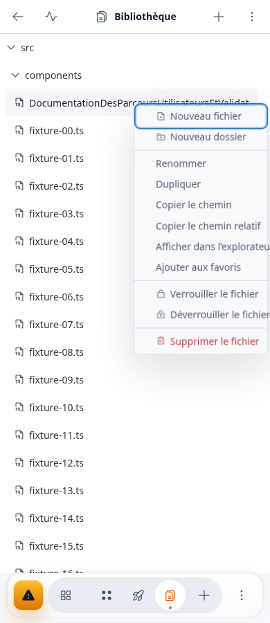
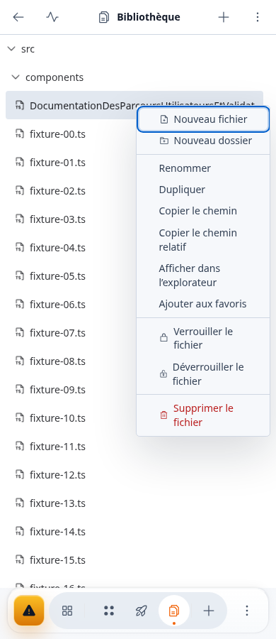
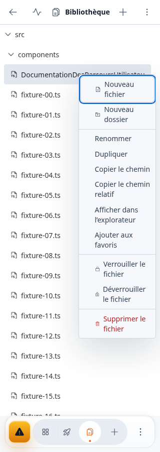
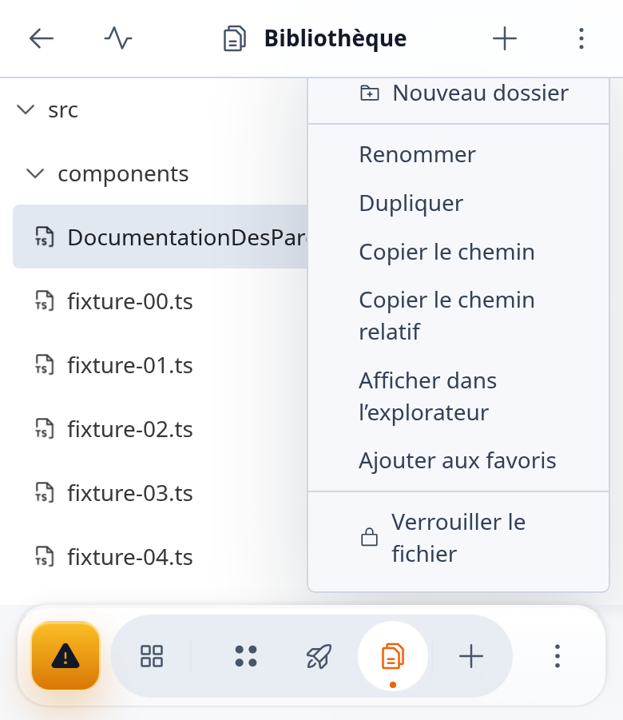
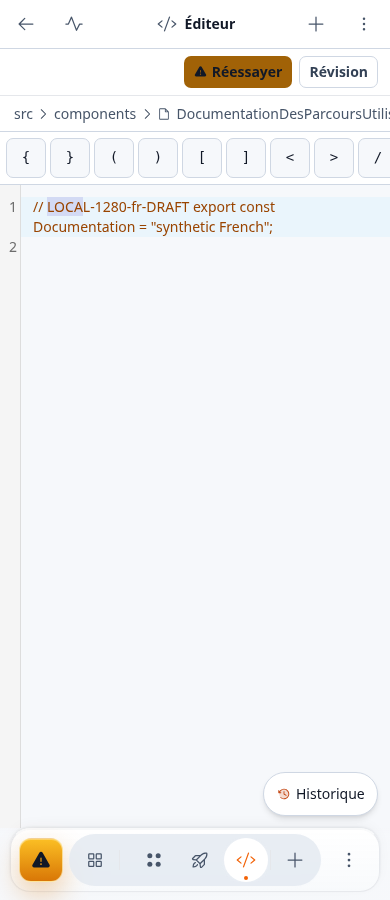

# Recette locale Files / Editor — 28 octobre 2026

Chromium, composants réels compilés, API synthétiques isolées. Aucune action de menu destructive exécutée et aucune donnée cliente utilisée.

## Menu Fichiers

Le build local final du premier assemblage passe 13/13 contextes : 320,360,390,820,1280 × FR/EN en thème clair ; paysage844 × FR/EN ;390 FR sombre. Home, ArrowDown, End, Escape et retour du focus parcourent143 cibles avec vérification géométrique et hit-test. Zéro erreur JavaScript. Un scénario supplémentaire au zoom navigateur natif 200 % passe les11 cibles, Escape et focus ; CSS390×450, fenêtre780×988, DPR2.

La recette courte sur le build assemblé suivant conserve ces résultats :320 FR et zoom natif200 %, 22 cibles,Escape/retour focus et navigation basse verts. Les sources FileTree et du hook Escape sont identiques à celles de la matrice 13 contextes.

## Éditeur — correction vérifiée localement

Le premier assemblage compilé passe390→1280,820→1280 avec sélection inversée, et conserve le focus extérieur1280→390. Mais Files→ouverture fichier sur desktop→resize1280→390 reste rouge : Agent est visible pendant trois frames, puis CodeMirror perd le focus et la sélection. Les tests unitaires verts ne remplacent pas cette contrepreuve. La réservation explicite du reçu autour du chargement lazy corrige ensuite les trois transitions de focus/sélection et conserve le focus extérieur. Une trace confirme le module réellement chargé à froid. Le témoin visuel restait rouge sur quatre images Agent avant la coque compacte. La préparation de la destination Editor dès la navigation URL élimine ensuite cette transition : sur le dernier build, les trois parcours passent aussi l’absence d’Agent mesurée par frames et mutations DOM. Le contrôle de focus extérieur passe séparément. Aucun délai ni assertion n’a été augmenté pour obtenir ce résultat.

Le transfert des documents CRLF reste une limite explicite : CodeMirror normalise LF ; le garde exact refuse le reçu de contenu différent plutôt que déplacer le curseur au mauvais offset.

Pas de validation production, Safari/appareil physique, clavier virtuel ou contraste exhaustif. Les captures illustrent les scénarios mesurés et ne certifient pas toute la plateforme.

[Reçu des trois transitions finales](editor-final.json). Les tests ciblés de l’assemblage passent146 cas ; après le dernier delta URL, les 20 tests concernés passent, avec lint ciblé et typage web. Le typage global et le lint global étaient verts avant ce dernier delta web ; le build client/SSR final passe. Les tests CodeMirror/jsdom émettent des diagnostics getClientRects malgré leur succès ; les recettes compilées complètent ces tests.

## Régression permanente

Un cas est ajouté au fichier E2E existant ide-editor-focus-handoff.spec.ts, sans modifier ses deux scénarios précédents. Il ouvre README depuis Files, passe de Monaco à CodeMirror puis revient, vérifie le détachement des anciens moteurs, le contenu et le focus, mesure la sélection 3–7 en offsets de ligne malgré la coloration syntaxique, puis remplace cette sélection par saisie native. Aucun refocus après changement de moteur. Le corps exact passe localement sur le build final, avec API et création de projet remplacées par des fixtures synthétiques ; la création API complète sera exécutée par la CI et ne l’a pas été localement. L’absence de flash Agent reste couverte par la recette visuelle distincte. Revue indépendante favorable, lint et formatage verts.
